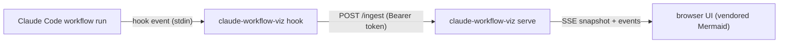

# claude-workflow-viz

> **Turn any Claude Code workflow run into a live Mermaid flowchart — passively, from hooks.**

Register one hook command, run `claude-workflow-viz serve`, and every workflow run in the
repo lights up a graph in your browser: stages running, passing, failing, and retrying as the
workflow's agents do the work. The visualiser observes the run from the outside; it never
touches the workflow itself. The step graph is configuration data, not tied to any one workflow.



- **An observer, not a driver.** Hooks forward events to a local server. If the visualiser
  dies mid-run, the workflow continues unaffected.
- **Silent by design.** The hook path always exits 0 and writes nothing to stdout or stderr —
  it can never disturb a session.
- **Zero build step.** One dependency (PyYAML), stdlib HTTP, and Mermaid vendored locally.
  No CDN, no bundler, no network at runtime.

---

## Core features

| Feature | What it gives you |
| --- | --- |
| **Live step graph** | Nodes light up as your workflow's agents run: running steps pulse, finished steps show pass/fail, retries render on the node. |
| **Verdict-driven colours** | A finished step's status is derived from its journal verdict (`APPROVED`, `CHANGES_REQUESTED`, `FAIL`, …) via a shared JSON rules file — one home for the strings the UI matches. |
| **Configurable graph** | One `.viz.yaml` file maps your workflow's stages and step keys to named nodes with pass/fail routing. Without one, a linear graph is built from the stages as they first appear. |
| **Session-scoped state** | Concurrent sessions are tracked separately: per-session steps, status history, run summaries. Bounded (64 sessions LRU, 5000 steps) so a long-lived server stays small. |
| **Locked-down transport** | Random 32-byte token, loopback binding only, `Host` header allowlist, body-size caps, and a connection file written 0600 and removed on shutdown — while it still holds the server's own token. |
| **Self-contained UI** | Static files served from the package with Mermaid vendored in-tree. Everything works offline. |

The fixed policies *are* the product: the token is never logged, an invalid or
missing token is a 401, an over-large payload is a 413, a malformed event is a
400 with a typed error code, and the hook side swallows everything — the
visualiser gets events only when everything is well-formed.

## Installation

**Prerequisites**

| Requirement | Detail |
| --- | --- |
| Python | ≥ 3.12 |
| Claude Code | Only for the hook side — the `serve` side runs anywhere. |

```sh
pipx install .
claude-workflow-viz --help
```

## Usage

### Subcommands

| Command | Purpose |
| --- | --- |
| `claude-workflow-viz serve [--port N] [--graph FILE]` | Run the local server (127.0.0.1 only) and the web UI. |
| `claude-workflow-viz hook` | Receive a Claude Code hook event on stdin and forward it to the server. |
| `claude-workflow-viz install [--viz-dir PATH] [--force]` | Wire a repo: verify, register the five hooks, create the `/viz` command. |

**1. Start the visualiser.**

```sh
claude-workflow-viz serve
# claude-workflow-viz listening on http://127.0.0.1:8322
# open the UI at http://127.0.0.1:8322/?token=<random-token>
```

`serve` prefers port 8322; when that port is busy it falls back to an OS-picked free port.
`--port 0` forces an OS-picked port. The actual bound port is printed on start and written
to the connection file. Open the printed URL — the page reads the token from the query
string and uses it for `/graph` and `/stream`. Ctrl-C shuts the server down and removes
the connection file.

`hook` finds `serve` through the connection file, so the two sides never share a config file:

| State directory, first match wins | |
| --- | --- |
| 1. `$CLAUDE_WORKFLOW_VIZ_STATE_DIR/server.json` | used as is |
| 2. `$XDG_STATE_HOME/claude-workflow-viz/server.json` | standard XDG state |
| 3. `~/.local/state/claude-workflow-viz/server.json` | default |

The file has mode 0600 and the directory (when created by the tool) mode 0700. It is created
with that mode from the start in a temporary file next to the target and moved into place with
`os.replace`, so a reader never sees a partial file and the token is never briefly world
readable. `serve` removes it on shutdown only while it still holds this server's token; a file
written by a newer server is left in place. A missing, unreadable or malformed file means no
server is running, and `hook` quietly does nothing.

**2. Register the hooks** in the repo where the workflow runs
(`.claude/settings.local.json`). The `install` subcommand writes these for you
(see "Installer" below); this JSON is the contract it writes:

```json
{
  "hooks": {
    "PreToolUse": [
      {"matcher": "Workflow", "hooks": [{"type": "command", "command": "claude-workflow-viz hook", "async": true}]}
    ],
    "PostToolUse": [
      {"matcher": "Workflow", "hooks": [{"type": "command", "command": "claude-workflow-viz hook", "async": true}]}
    ],
    "SubagentStart": [
      {"hooks": [{"type": "command", "command": "claude-workflow-viz hook", "async": true}]}
    ],
    "SubagentStop": [
      {"hooks": [{"type": "command", "command": "claude-workflow-viz hook", "async": true}]}
    ]
  }
}
```

`async` keeps the hook off the workflow's critical path; `claude-workflow-viz hook` reads the
payload from stdin, forwards it, and exits 0 no matter what.

**3. Run the workflow.** The graph updates live.

**What a run looks like:**

1. **serve** binds 127.0.0.1, generates the token, writes the 0600 connection
   file, and prints the UI URL.
2. **The workflow runs.** Each `SubagentStart`/`SubagentStop` and Workflow
   `PreToolUse`/`PostToolUse` becomes an event and lands in the server's run
   state, keyed by session.
3. **Nodes light up.** Steps are matched to nodes by `stage` or exact
   `step_key`; a node without a step renders pending.
4. **Verdicts paint the graph.** When a step finishes, its journal verdict
   (`APPROVED`, `PASS`, …) decides the node's pass/fail colour; unknown
   verdicts fall back to the step's reported status.
5. **Routes fire.** Pass and fail edges highlight, retries re-open nodes, and
   exhausting `max_rounds` routes to the `on_rounds_exhausted` terminal.

### Installer

`claude-workflow-viz install` wires a repo in one command:

```sh
claude-workflow-viz install [--viz-dir <path>] [--force]
```

It first verifies the tool by running `claude-workflow-viz hook` once with empty stdin.
Then it writes the five hook registrations into `.claude/settings.local.json`.
The registrations are the four hooks shown above plus `SessionEnd`.
It also creates `.claude/commands/viz.md`, the `/viz` command the agent fallback runs.
Existing unrelated hooks are preserved, and an already-wired repo is left byte-for-byte unchanged.
Re-running is safe: the second install re-verifies and reprints the summary but writes nothing.

- `--viz-dir <path>` picks the directory for agent-generated `.viz.yaml` files.
  The default is `.claude-local/viz/`. The choice is recorded in the `/viz` command file.
- `--force` overwrites an existing `.claude/commands/viz.md`; without it the command is skipped.

On the next workflow run the `PreToolUse` hook bootstraps the visualiser, as described in
"Invoke-time bootstrap".

### Invoke-time bootstrap

When a workflow starts, the Workflow `PreToolUse` hook bootstraps the visualiser.
No manual `serve` step is needed:

1. The hook reads the connection file and probes `GET /graph` to see whether a server is
   already running. A live server is reused unchanged.
2. The hook statically parses the invoked workflow's JavaScript
   (`<repo>/.claude/workflows/<name>.js`) into the graph contract and writes
   `<state>/graphs/<name>.viz.yaml`. Other workflows' caches are left untouched.
3. If no server is live, the hook spawns `serve` detached on the preferred port 8322,
   falling back to a free port when busy. The server's output goes to the state-dir debug log,
   never the hook's stream.
4. The hook waits at most 10 seconds for the connection file, then opens the dashboard at
   `/?token=<token>&workflow=<name>` in the default browser.

If the workflow cannot be parsed, no cache is written and the server starts in linear mode;
the dashboard shows the unmapped-step warning, and the state-dir debug log carries the
parser's failure summary. `SessionEnd` stops the server by posting `/shutdown`.

### Server endpoints

| Endpoint | Auth | Behaviour |
| --- | --- | --- |
| `POST /ingest` | `Authorization: Bearer <token>` | One JSON event, at most 64 KiB. 204 applied, 400 bad JSON or invalid event, 401 missing or wrong token, 413 body too large. |
| `POST /shutdown` | `Authorization: Bearer <token>` | Stops the server and removes its connection file (the same sequence as Ctrl-C). 401 on a missing or wrong token, 204 on success. |
| `GET /` | none (the page itself holds no run data) | The web UI HTML. Open it as `/?token=<token>`; the page reads the token from the URL and uses it for `/graph` and `/stream`. |
| `GET /static/<file>` | none | A file from the package's `static` directory (`app.js`, `viz-core.js`, `styles.css`, `mermaid.min.js`, `status_rules.json`, ...). Only existing `.html`, `.js`, `.css` and `.json` files are served; anything else, including `VENDORED.md` and `mermaid.LICENSE`, is 404. |
| `GET /graph?token=<token>[&workflow=<name>]` | `token` query parameter | JSON `{"graph", "source", "status_rules"}`. `source` is `config` when a graph was supplied (`serve --graph` or the per-workflow registry), else `linear`. `workflow=<name>` serves that workflow's graph from `<state>/graphs/<name>.viz.yaml`; an unknown name falls back to linear. 401 on a missing or wrong token. |
| `GET /stream?token=<token>` | `token` query parameter (a browser `EventSource` cannot set headers) | `text/event-stream`. First a `snapshot` event with the current run state, then one `event` per applied event, with a `: keep-alive` comment every 15 seconds. 401 on a missing or wrong token. |

Every endpoint accepts only a `Host` header of `127.0.0.1:<port>` or `localhost:<port>` (the
IPv6 form `[::1]:<port>` is not accepted because the server binds IPv4 only); a missing or any
other `Host` gets 421 before the token check. A request body that stalls for 10 seconds, such
as fewer bytes than its `Content-Length`, closes the connection. Any other path returns 404.

### Run state and limits

The `snapshot` event (and `RunState.snapshot()`) has this shape per session:

```json
{"sessions": {"<session_id>": {
  "steps": {"<step_key>": {"statuses": ["running", "pass"], "summary": "", "finished": true,
                           "agent_id": "", "run_id": "", "slice": "", "stage": "",
                           "round": null, "phase": "", "result": null,
                           "node_status": "pending | running | pass | fail | retry"}},
  "runs": {"<run_id>": {"status": "running | finished", "step_keys": ["<step_key>"]}},
  "events": []}}}
```

Steps with an `agent_id` are paired by it, so a start and stop pair even when their step keys
differ; a stop with no start creates a finished step, and a start with an `agent_id` arriving
after its stop does not reopen it. A start without an `agent_id` on a finished step is a retry
round: it appends its status and reopens the step. A run is `running` while any step is
unstopped and `finished` once it has steps and all have stopped; a step start that opens a step
returns a finished run to `running`. An explicit `run_stop` is final for that run id: a later
`run_start` or step start never returns it to `running` (step fields still update). The snapshot
flags each such run with `stopped: true`, so a client that reconnects after the `run_stop` event
has aged out of the event log keeps the run finished.

Run state is bounded so a misbehaving client cannot grow server memory without limit:

| Limit | Value | When exceeded |
| --- | --- | --- |
| Sessions | 64 | A new session evicts the least recently updated one (every applied event updates its session; this is not the oldest created). |
| Steps per session | 5000 | An event that resolves to a new step key creates no step and does not change run status. It is still logged in `events` and delivered to `/stream` subscribers. Existing steps keep updating. |
| Statuses per step | 100 | Only the last 100 are kept, in order; the oldest is dropped. |

A step's `result` is copied when stored, so later changes to the incoming event do not affect it.

### Graph configuration

`serve --graph FILE` loads the step graph from a `.viz.yaml` file; an invalid file makes `serve`
exit with an error instead of starting. Without `--graph` the server builds a linear graph: one
node per distinct stage seen in events (first-seen order), ending in `done`. A stage named
`done`, `blocked` or `needs-context` gets the node id `stage-<stage>` (plus a numeric suffix if
that id is taken) so it never collides with a terminal node; the node keeps the original stage
and label.

Schema (see `examples/implement.viz.yaml`):

| Key | Meaning |
| --- | --- |
| `name`, `entry` | Graph name and the id of the first node. |
| `max_rounds`, `on_rounds_exhausted` | Optional retry limit and the node to go to when it is used up. |
| `step_pattern` | Optional regex with named groups `slice`, `stage`, `round`; `stage` is required. Rejected: longer than 200 characters; nested quantifiers such as `(a+)+`, `(a*)*`, `(?:a+)*`, `(a{1,})+`; Python-only syntax the UI cannot convert (`(?P=name)`, inline flags `(?i)` or `(?i:...)`); anything Python cannot compile, including variable-width lookbehind. `(?P<name>...)` is allowed. |
| `nodes[]` | `id`, `label`, one of `stage` or `step_key` to match events, `terminal: true` for end nodes, `on_pass` / `on_fail` as the ids to go to next. |

A value may not be one node's `stage` and another node's `step_key`; `serve --graph` rejects such
a file and names both nodes and the value. One node may use the same value for both. A duplicate
key anywhere in the file is rejected with the key and its line number.

```yaml
name: implement
entry: pre-flight
max_rounds: 3
on_rounds_exhausted: blocked
nodes:
  - {id: pre-flight, label: Pre-flight, step_key: pre-flight/head-check, on_pass: planner, on_fail: blocked}
  - {id: develop, label: Develop, stage: develop, on_pass: gate, on_fail: blocked}
  - {id: gate, label: Gate, stage: gate, on_pass: review, on_fail: develop}
  - {id: done, label: Done, terminal: true}
  - {id: blocked, label: Blocked, terminal: true}
```

Every validation failure returns a typed error code (`GraphError`) naming the node and field —
never a stack trace.

### Static parse subset

At invoke time the visualiser statically parses the invoked workflow's JavaScript into the same `.viz.yaml` schema above.
The parser code is the authoritative subset definition.
Anything outside the subset is a named failure — never a guessed graph — and degrades to a hand-authored fallback.

| Construct | Parsed as |
| --- | --- |
| `export const meta = { name }` | graph `name` |
| `const MAX_ROUNDS = <int>` | `max_rounds`; `if (round >= MAX_ROUNDS) return X` → `on_rounds_exhausted` |
| `agent(...)` with a string-literal label | a `step_key` node matched on the whole label |
| `agent(...)` with a `${slice}/<stage>:r${round}` template label | a `stage` node matched on the literal stage |
| `while`/`for` with `continue` back to an earlier agent | a loop-back `on_fail` edge to the re-entered node |
| early `return DONE` / `BLOCKED` / `NEEDS_CONTEXT` | terminal nodes `done` / `blocked` / `needs-context` |
| an `if`-guarded agent with no agent in the `else` | a normal node (the guard is not encoded) |
| `Promise.all` of `agent(...)` calls | one node per member |

Each construct outside the subset produces one typed `ParseFailure`, collected exhaustively in one pass.
The codes are `unsupported-label`, `missing-max-rounds`, `unsupported-control-flow`, `unsupported-terminal`, `unsupported-conditional`, and `unsupported-parallel`, plus `missing-meta` and `no-agent-calls`.
A report, not a partial graph, is the result whenever any failure is found.

## Development environment

```sh
uv run pytest
uv run ruff check          # lint (E, F, W, I, B, UP, SIM, N)
uv run ruff format --check # formatting
node --test tests/js       # the browser-side status logic in static/viz-core.js; needs node
```

- Development is strict TDD — the history is red/green slices; each slice's red commit names
  the test it fails.
- `tests/fixtures/probe_payloads.jsonl` holds real Claude hook payloads captured from a live
  run; the adapter tests replay them.
- `docs/plan.md` records the architecture decisions — the hook-driven design and why the
  transcript-tail adapter was deferred (the Phase 0 probe proved it unnecessary).

### Agentic dev loop

The repo's default development mode is the user driving the [agentic-dev-loop](https://pypi.org/project/agentic-dev-loop/) construction pipeline — see `AGENTS.md` ("Default development mode — ASK BEFORE CODING").

```sh
pipx install agentic-dev-loop   # outside the workspace — never editable, never in the repo .venv
export OPENAI_API_KEY=...       # no .env files — the engine refuses a run when the workspace has .env*
./trigger-agentic-dev-loop.sh --plan planning-docs/your-plan.md
```

- The trigger pipx-upgrades the engine on every run, so a stale install can't reject newer pipeline configs.
- The pipeline prints a thread id on every run;
  resume a crashed run with `--resume <thread-id>`.
- The viz web server runs on `http://localhost:8321` by default;
  disable with `--no-viz`.
- `agentic-dev-loop/` is an example to adapt:
  `pipeline.yaml` (steps `dev → restore → test → review → qa → commit`, `deps_policy: open`)
  and `sdk_agents/{dev,review,qa}.agent.md`.
  The example restore/test commands install the project and the dev tools
  directly (`pytest`, `ruff`, `pip-audit`) — dev deps live in uv's `[dependency-groups]`, so there is no `.[dev]` extra to install.

### Agent instructions and standards

- `AGENTS.md` — ask-before-coding default, TDD, mock policy, writing/tone rules.
- `coding-standards-ddd.yaml` — DDD + simple-code standards;
  `/load-backend-rules` loads it into a session before backend work.
- `.aidlc/aidlc-rules/` — AWS AI-DLC ruleset;
  the entry point is `aws-aidlc-rules/core-workflow.md`.
  Working docs (plans, user stories, unit-of-work, state) live in `aidlc-docs/`.
- `.opencode/` — Builder (default), Planner, and Readonly agents;
  commands `/apply-aidlc-patches`, `/epic-status`, `/export-opencode-tools-to-claude`, `/figma`, `/load-backend-rules`, `/postmortem`, `/software-selection`, `/ticket-details`, `/unit-status`, `/update-subtask`;
  skills `brainstorming`, `hypothesis-generation`, `writing-plans`.

## Contributing

- Keep the two contracts sacred: **the hook is always silent** (exit 0, empty stdout/stderr,
  swallows `BaseException`), and **the snapshot JSON shape is the UI's API** — it must not
  change without the JS tests.
- All validation returns typed result objects (`EventError`, `GraphError`) — no exceptions for
  expected conditions.
- Mermaid is vendored (`src/claude_workflow_viz/static/`) — no CDN.

---

Built on [Claude Code hooks](https://docs.claude.com/en/docs/claude-code/hooks)
and [Mermaid](https://mermaid.js.org/) (vendored, MIT).
