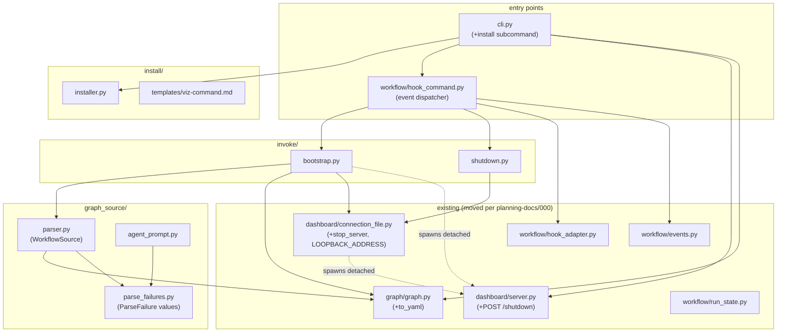

# Component Dependencies

Dependency directions for unit-1. New modules may import existing ones; existing modules
only gain the changes listed in components.md. Import-cycle check: none introduced.



Text alternative:

```
cli.py ──► install/installer.py, workflow/hook_command.py,
           dashboard/server.py, graph/graph.py

workflow/hook_command.py ──► invoke/bootstrap.py, invoke/shutdown.py,
                             workflow/hook_adapter.py, workflow/events.py

invoke/bootstrap.py ──► graph_source/parser.py, graph/graph.py,
                        dashboard/connection_file.py
invoke/bootstrap.py ─spawns detached─► dashboard/server.py (serve process)

invoke/shutdown.py ──► dashboard/connection_file.py (stop_server)

graph_source/parser.py ──► graph/graph.py (Graph), graph_source/parse_failures.py
graph_source/agent_prompt.py ──► graph_source/parse_failures.py

dashboard/connection_file.py  (LOOPBACK_ADDRESS relocated from dashboard/server.py)
```

Solid arrows are imports; dashed arrows are detached subprocess spawns (no import — the
process boundary between a hook and a server is the product's existing shape).

## Notes

- `invoke/bootstrap.py` spawns `serve` via `subprocess` (`sys.executable -m
  claude_workflow_viz serve ...`) — deliberately no import: the server is a separate,
  long-lived process; the hook must stay exit-fast.
- `dashboard/connection_file.py` now owns `LOOPBACK_ADDRESS` (relocated from
  `dashboard/server.py`). This resolves the planning-docs/000 open decision in the
  alternative's favour: `Connection.stop_server()` needs the address, and importing
  `server` from `connection_file` would cycle (`server` already imports
  `connection_file`).
- `workflow/hook_command.py` keeps its existing import of the connection-file and server
  modules for forwarding; the dispatcher branch adds the two `invoke/` imports only.
- No component imports `install/` except `cli.py` — the installer is never on the hook
  path, so install-time choices cannot disturb a session.
- No cycle through `graph_source/`: it depends only on `graph/` and its own
  `parse_failures.py`; `invoke/` depends downward on `graph_source/` and `dashboard/`.
