# Execution Plan

## Detailed Analysis Summary

### Transformation Scope (Brownfield)
- **Transformation Type**: Single-package change with new components — the `claude_workflow_viz`
  package gains installer, static-parser, and invoke-time bootstrap components; no
  architectural transformation, no infrastructure, no deployment-model change.
- **Primary Changes**: dynamic graph generation (static analysis + agent fallback),
  install-time bootstrap (hooks into settings.local.json), invoke-time bootstrap
  (PreToolUse hook: generate graph, start server, open dashboard), SessionEnd stop hook,
  Claude Code command entry point, README smoke-test fix.
- **Related Components**: `cli.py` (new subcommands), `hook_command.py`/`hook_adapter.py`
  (invoke-time wiring), `graph.py` (reused unchanged), `connection_file.py` (reused
  unchanged), `server.py` (reused unchanged), static UI (reused unchanged), `pyproject.toml`
  (entry points), README + smoke test.

### Change Impact Assessment
- **User-facing changes**: Yes — bootstrap becomes a single command; dashboard auto-opens;
  no hand-authored graph yaml needed.
- **Structural changes**: Yes — new modules within the existing package; no rework of
  existing modules' contracts.
- **Data model changes**: No — `Event`/`RunState`/`Graph` data models unchanged.
- **API changes**: Yes — new CLI surface (installer, invoke-time commands) and a new
  SessionEnd hook contract; HTTP endpoints unchanged.
- **NFR impact**: Yes — Security (blocking), PBT (partial), Resiliency (minimal) extensions
  all apply to the new surface.

### Component Relationships
- **Primary Component**: `claude_workflow_viz` package
- **Infrastructure Components**: none (desktop tool, pipx-installed)
- **Shared Components**: `graph.py` validation schema, `status_rules.json`, `static/` UI —
  all reused without change
- **Dependent Components**: workflow-examples (external integration target; no code changes
  from this repo, integration exercised via its `.claude/workflows/*.js`)
- **Supporting Components**: tests (pytest + Node), README, dev-loop pipeline
  (`agentic-dev-loop/pipeline.yaml`)

### Risk Assessment
- **Risk Level**: Medium — multiple new components, but rollback is trivial (git revert of a
  local tool), the domain is well understood from reverse engineering, and the event
  pipeline is untouched.
- **Rollback Complexity**: Easy
- **Testing Complexity**: Moderate — parser subset needs a fixture corpus of workflow JS
  shapes; invoke-time path needs integration tests against a fake hook payload stream.

## Workflow Visualization

```mermaid
flowchart TD
    Start(["User Request"])

    subgraph INCEPTION["INCEPTION PHASE"]
        WD["Workspace Detection<br/><b>COMPLETED</b>"]
        RE["Reverse Engineering<br/><b>COMPLETED</b>"]
        RA["Requirements Analysis<br/><b>COMPLETED</b>"]
        US["User Stories<br/><b>SKIP</b>"]
        WP["Workflow Planning<br/><b>IN PROGRESS</b>"]
        AD["Application Design<br/><b>EXECUTE</b>"]
        UG["Units Generation<br/><b>EXECUTE</b>"]
    end

    subgraph CONSTRUCTION["CONSTRUCTION PHASE"]
        FD["Functional Design<br/><b>EXECUTE</b>"]
        NFRA["NFR Requirements<br/><b>EXECUTE</b>"]
        NFRD["NFR Design<br/><b>EXECUTE</b>"]
        ID["Infrastructure Design<br/><b>SKIP</b>"]
        CG["Code Generation<br/><b>EXECUTE</b>"]
        BT["Build and Test<br/><b>EXECUTE</b>"]
    end

    subgraph OPERATIONS["OPERATIONS PHASE"]
        OPS["Operations<br/><b>PLACEHOLDER</b>"]
    end

    Start --> WD
    WD --> RE
    RE --> RA
    RA --> US
    US --> WP
    WP --> AD
    AD --> UG
    UG --> FD
    FD --> NFRA
    NFRA --> NFRD
    NFRD --> ID
    ID --> CG
    CG --> BT
    BT --> OPS
    OPS --> End(["Complete"])

    style WD fill:#4CAF50,stroke:#1B5E20,stroke-width:3px,color:#fff
    style RE fill:#4CAF50,stroke:#1B5E20,stroke-width:3px,color:#fff
    style RA fill:#4CAF50,stroke:#1B5E20,stroke-width:3px,color:#fff
    style WP fill:#4CAF50,stroke:#1B5E20,stroke-width:3px,color:#fff
    style AD fill:#FFA726,stroke:#E65100,stroke-width:3px,stroke-dasharray: 5 5,color:#000
    style UG fill:#FFA726,stroke:#E65100,stroke-width:3px,stroke-dasharray: 5 5,color:#000
    style FD fill:#FFA726,stroke:#E65100,stroke-width:3px,stroke-dasharray: 5 5,color:#000
    style NFRA fill:#FFA726,stroke:#E65100,stroke-width:3px,stroke-dasharray: 5 5,color:#000
    style NFRD fill:#FFA726,stroke:#E65100,stroke-width:3px,stroke-dasharray: 5 5,color:#000
    style US fill:#BDBDBD,stroke:#424242,stroke-width:2px,stroke-dasharray: 5 5,color:#000
    style ID fill:#BDBDBD,stroke:#424242,stroke-width:2px,stroke-dasharray: 5 5,color:#000
    style CG fill:#4CAF50,stroke:#1B5E20,stroke-width:3px,color:#fff
    style BT fill:#4CAF50,stroke:#1B5E20,stroke-width:3px,color:#fff
    style OPS fill:#BDBDBD,stroke:#424242,stroke-width:2px,stroke-dasharray: 5 5,color:#000
    style Start fill:#CE93D8,stroke:#6A1B9A,stroke-width:3px,color:#000
    style End fill:#CE93D8,stroke:#6A1B9A,stroke-width:3px,color:#000

    linkStyle default stroke:#333,stroke-width:2px
```



Text alternative (ASCII):

```
User Request
    |
    v
INCEPTION PHASE
  Workspace Detection   [COMPLETED]
    |
    v
  Reverse Engineering  [COMPLETED]
    |
    v
  Requirements Analysis [COMPLETED]
    |
    v
  User Stories          [SKIP]
    |
    v
  Workflow Planning     [IN PROGRESS]
    |
    v
  Application Design    [EXECUTE]
    |
    v
  Units Generation      [EXECUTE]
    |
    v
CONSTRUCTION PHASE (per unit)
  Functional Design     [EXECUTE]
    |
    v
  NFR Requirements      [EXECUTE]
    |
    v
  NFR Design            [EXECUTE]
    |
    v
  Infrastructure Design [SKIP]
    |
    v
  Code Generation       [EXECUTE]
    |
    v
  Build and Test        [EXECUTE]
    |
    v
OPERATIONS PHASE
  Operations            [PLACEHOLDER]
    |
    v
  Complete
```

## Phases to Execute

### INCEPTION PHASE
- [x] Workspace Detection (COMPLETED)
- [x] Reverse Engineering (COMPLETED)
- [x] Requirements Analysis (COMPLETED)
- [x] User Stories (SKIPPED)
  - **Rationale**: Developer-facing tool enhancement with concrete FRs already written; no
    multiple personas or end-user UX discovery needed. (User was offered the stage and
    approved without adding it.)
- [x] Execution Plan (IN PROGRESS)
- [ ] Application Design - EXECUTE
  - **Rationale**: Unit-1 introduces several new components (installer, strict workflow-JS
    parser, agent-fallback generator, invoke-time bootstrap, SessionEnd stop) whose methods
    and business rules need definition before code. Domain Standards extension (blocking)
    applies here: two-phase domain exposition and validation.
- [ ] Units Generation - EXECUTE
  - **Rationale**: Multiple new modules, a complex parsing algorithm, and new CLI surface —
    decomposition into units and their construction order matters.

### CONSTRUCTION PHASE
- [ ] Functional Design - EXECUTE
  - **Rationale**: New components with real business rules (parse subset boundaries,
    fallback triggering, hook lifecycle). Domain Standards extension applies here; PBT-01
    property identification happens here.
- [ ] NFR Requirements - EXECUTE
  - **Rationale**: Security extension (blocking) and PBT-09 framework selection require an
    NFR assessment of the new surface.
- [ ] NFR Design - EXECUTE
  - **Rationale**: Resiliency clarifying questions were deferred here (user instruction);
    security design for the installer/hook-spawned server path.
- [ ] Infrastructure Design - SKIP
  - **Rationale**: Desktop tool installed via pipx — no cloud infrastructure, IaC, or
    deployment topology. The "infrastructure" (state dir, connection file, hooks wiring)
    is application configuration, designed in Functional Design.
- [ ] Code Generation - EXECUTE (ALWAYS)
  - **Rationale**: Implementation planning and code generation needed.
- [ ] Build and Test - EXECUTE (ALWAYS)
  - **Rationale**: Build, test, and verification needed; README smoke-test fix lands here.

### OPERATIONS PHASE
- [ ] Operations - PLACEHOLDER
  - **Rationale**: Future deployment and monitoring workflows.

## Package Change Sequence (Brownfield)

Single Python package — no multi-module sequencing. Order within construction follows the
unit decomposition produced at Units Generation. Integration checkpoints:
- After parser unit: fixture corpus of workflow JS shapes parses; named failures for
  everything outside the subset.
- After installer unit: hooks written idempotently into a scratch `.claude/settings.local.json`.
- After invoke-time unit: end-to-end smoke against workflow-examples' implement.js —
  graph served without any hand-authored yaml (success criterion).

## Estimated Timeline
- **Total Phases**: 9 to execute (Application Design, Units Generation, Functional Design,
  NFR Requirements, NFR Design, Code Generation, Build and Test) + 2 skipped
  (User Stories, Infrastructure Design)
- **Estimated Duration**: 1-2 focused working sessions, plus review cycles

## Success Criteria
- **Primary Goal**: After bootstrap in workflow-examples and running /implement, the
  dashboard shows the correct live graph — nodes, retries, loop-backs, verdict colours —
  with zero hand-authored graph config, reachable without manual serve steps.
- **Key Deliverables**: installer (hooks + viz-dir choice), strict workflow-JS parser with
  named failures, agent-generated fallback yaml in the existing schema, invoke-time hook
  bootstrap with auto-open dashboard, SessionEnd stop hook, Claude Code command, README
  updated and smoke test green.
- **Quality Gates**: full pytest suite green (including the fixed smoke test), Node
  viz-core suite green, ruff clean, security-baseline compliance section with no blocking
  findings, PBT properties for new pure functions, no regressions in existing
  ingest/SSE/graph behaviour.
- **Integration Testing**: end-to-end run against workflow-examples' /implement proves the
  success criterion.
- **Operational Readiness**: N/A for unit-1 (Operations placeholder).

---

## Amendment (2026-10-25, Application Design D7)

The existing nine flat modules will be moved into DDD-style subfolders
(`workflow/`, `graph/`, `dashboard/`) before unit-1 work begins. This move is
standalone work outside the AI-DLC unit structure (user: "This is separate from
ai-dlc units. unit-1 can assume it's already been done.") — documented in
`planning-docs/000-move-existing-modules-into-ddd-folders.md`. Unit-1's design
assumes the moved layout. It is a preserve-behaviour refactor; the previously
stated constraint "existing contracts untouched" still holds — no public contract
changes, module paths only.
