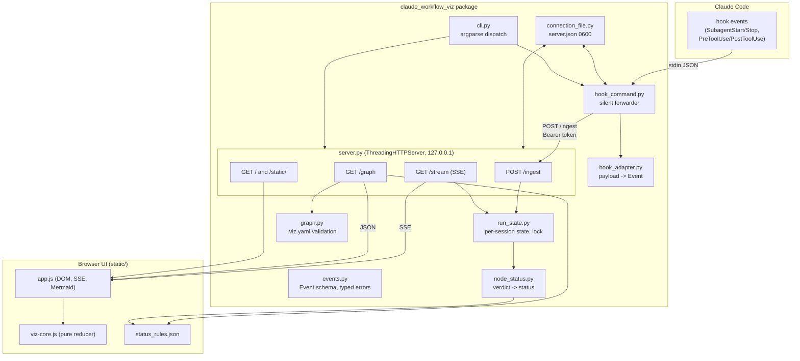
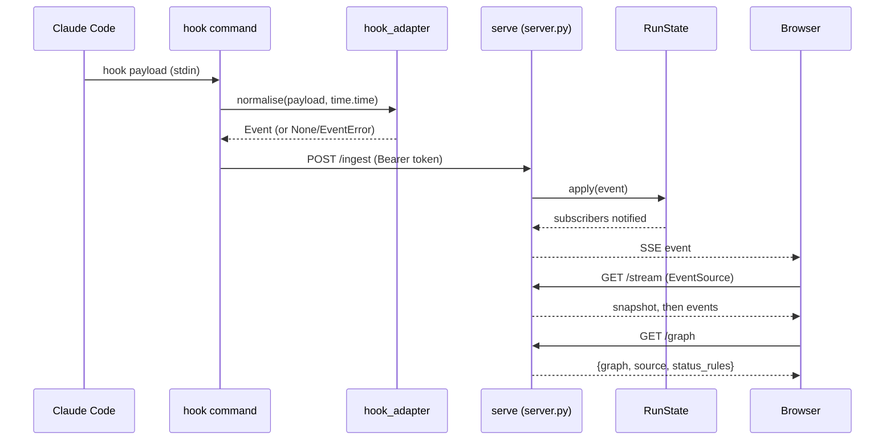

# System Architecture

## System Overview

A single Python package (`claude_workflow_viz`) with two CLI entry points — `serve` and `hook` —
plus a self-contained static web UI. `hook` is registered in Claude Code and runs on every hook
event; it normalises the payload and POSTs it to `serve` on 127.0.0.1. `serve` holds per-session
run state behind one lock, serves the UI and a JSON graph document, and streams live events over
SSE. The browser renders the graph with a vendored Mermaid and applies status changes to the
already-drawn SVG. The whole system is offline: one runtime dependency (PyYAML), stdlib HTTP,
Mermaid vendored in-tree.

## Architecture Diagram

Text alternative: Claude Code fires hooks; `hook` reads each payload from stdin, normalises it
via `hook_adapter`, and POSTs the event to `serve`'s `/ingest` endpoint using the token from the
connection file; `serve` applies the event to `run_state` and streams it to every SSE subscriber;
the browser fetches `/graph` once (re-fetching in linear mode when a new step appears) and
re-renders via `viz-core.js` + Mermaid.

## Component Descriptions

### cli.py
- **Purpose**: Command line entry point (`claude-workflow-viz` console script).
- **Responsibilities**: Dispatch `serve` (with `--port` and `--graph`) and `hook`.
  The `hook` path bypasses argparse entirely so nothing, not even a usage error, reaches
  stderr on the hook path.
- **Dependencies**: graph (Graph.load), hook_command (run_hook), server (serve).
- **Type**: Application

### hook_command.py
- **Purpose**: The `hook` subcommand: forward one hook payload to the running server.
- **Responsibilities**: Read stdin JSON, normalise, read the connection file, POST to
  `/ingest` with a Bearer token, a 1-second timeout, and an empty ProxyHandler so the token
  only goes to the local server. Swallows every exception (even BaseException) and always
  returns 0; writes nothing to stdout or stderr.
- **Dependencies**: connection_file, events, hook_adapter, server (LOOPBACK_ADDRESS).
- **Type**: Application

### hook_adapter.py
- **Purpose**: Turn a Claude Code hook payload into a normalised `Event`.
- **Responsibilities**: Classify hook events (SubagentStart/Stop, PreToolUse/PostToolUse on
  `Agent` and `Workflow`) into run/step start/stop; identify steps from the transcript
  basename, agent_type, description or subagent_type; resolve workflow identity (run id,
  step label, phase) from `agent-<agent_id>.meta.json`; read the run journal for the
  structured result at workflow stop. All reads defensive; never raises.
- **Dependencies**: events.
- **Type**: Application

### server.py
- **Purpose**: Localhost server: token-guarded event ingest, SSE stream, graph document,
  static UI.
- **Responsibilities**: Bind 127.0.0.1 only; Host header allowlist (421 before token check);
  token check on `/ingest` (Bearer), `/stream` and `/graph` (query param); body cap 64 KiB
  (413); malformed event 400; SSE with initial snapshot then events under one lock; hardened
  headers (CSP, nosniff, no-store) on static files; connection file written on start and
  removed on shutdown while it still holds its own token.
- **Dependencies**: connection_file, events, graph, run_state.
- **Type**: Application

### run_state.py
- **Purpose**: Thread-safe in-memory state for every observed workflow run.
- **Responsibilities**: Per-session steps (status history, summary, workflow fields, result),
  run statuses (running/finished, explicit stop final), bounded event log; subscribe with
  snapshot under one lock so each event is delivered exactly once; hard bounds (64 sessions
  LRU, 5000 steps per session, 100 statuses per step, 1000 events).
- **Dependencies**: events, node_status.
- **Type**: Application (state model)

### graph.py
- **Purpose**: Load and strictly validate `<workflow>.viz.yaml`.
- **Responsibilities**: YAML parse with duplicate-key and unknown-key rejection; validate
  node ids, stages, step_keys, terminal flags, on_pass/on_fail references, entry, max_rounds
  and step_pattern (length, nested quantifiers, Python-only syntax); fallback `Graph.linear`
  for the no-config mode. Every failure is a typed `GraphError`, never an exception.
- **Dependencies**: events (none — pure), pyyaml.
- **Type**: Application (config model)

### connection_file.py
- **Purpose**: Ingest token generation and the connection file that lets `hook` find `serve`.
- **Responsibilities**: State directory resolution (env var, XDG_STATE_HOME, ~/.local/state);
  atomic write of `server.json` (`{"port", "token"}`) via temp file + os.replace with 0600
  mode; read that never raises; remove only while the file still holds the caller's token;
  constant-time token comparison.
- **Dependencies**: none beyond stdlib.
- **Type**: Application (infrastructure)

### node_status.py
- **Purpose**: Display status derived from the shared rules in `status_rules.json`.
- **Responsibilities**: Read the rules file from package resources; map a structured result's
  verdict fields (in rule order, case-insensitive) to pass/fail.
- **Dependencies**: static/status_rules.json (package resource).
- **Type**: Application (shared rule reader)

### static/ (app.js, viz-core.js, index.html, styles.css, status_rules.json, mermaid.min.js)
- **Purpose**: The browser UI: live flowchart and step console, no build step.
- **Responsibilities**: `viz-core.js` is a pure reducer (no DOM, runnable under Node tests);
  `app.js` wires it to the DOM, SSE and Mermaid; `index.html` declares the header, graph
  section, console aside and selectors; `status_rules.json` is the single source of verdict
  strings shared by Python and JS.
- **Dependencies**: Mermaid (vendored, in-tree).
- **Type**: Application (client)

## Data Flow

Text alternative: hook payload → normalised Event → POST /ingest → RunState.apply → SSE
delivery; browser initialises from the snapshot and the graph document, then applies each
event to the rendered SVG.

## Integration Points

- **External APIs**: none. The only HTTP traffic is loopback between `hook` and `serve`
  (POST /ingest) and between the browser and `serve` (SSE, graph, static).
- **Databases**: none. State is in-memory per server process; nothing is persisted.
- **Third-party Services**: none at runtime. Mermaid is vendored; PyYAML is the only runtime
  library dependency.

## Infrastructure Components

- **CDK Stacks**: none.
- **Deployment Model**: pipx-installable Python wheel (`hatchling`); `serve` runs on the
  developer's machine; no containers in the product itself (the repo's dev loop uses a
  sandboxed venv, see agentic-dev-loop/).
- **Networking**: bound to 127.0.0.1 only; Host header allowlist; no TLS (loopback only).
