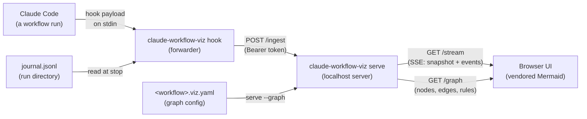

# Business Overview

## Business Context Diagram

Text alternative: a Claude Code workflow run fires hooks; the `hook` subcommand reads each
payload from stdin, normalises it, and POSTs it to the local `serve` process; the browser opens
the server's SSE stream and renders the run as a Mermaid flowchart; an optional `.viz.yaml`
config supplies the graph nodes and pass/fail routing.

## Business Description

- **Business Description**: claude-workflow-viz turns any Claude Code Workflow run into a live
  Mermaid flowchart, passively. One registered hook command forwards workflow activity to a
  local server; the browser renders nodes that light up as steps run, pass, fail and retry.
  The visualiser observes the run from the outside and never touches the workflow itself.
  The step graph is configuration data, not tied to any one workflow. The tool is a
  proof-of-concept modelled on the `agentic-dev-loop` PyPI package (the repo owner is the
  author of that tool), and its example graph (`examples/implement.viz.yaml`) mirrors that
  tool's dev/test/review/qa pipeline.
- **Business Transactions**:
  1. **Workflow-run observation** — every Claude Code hook event (subagent start/stop,
     tool use on `Agent` and `Workflow`) is read from stdin, normalised to a typed event,
     and delivered to the local server. Observation is silent by design: the hook path
     always exits 0 and writes nothing, so it can never disturb a session.
  2. **Live run visualisation** — the browser subscribes to the server's SSE stream, receives
     an initial snapshot plus each subsequent event, and re-renders node status classes,
     the active edge, retry loop-back edges, and a per-node console pane in real time.
  3. **Graph configuration** — a `<workflow>.viz.yaml` file maps a workflow's stages and step
     keys to named nodes with `on_pass`/`on_fail` routing and an entry node; without one,
     a linear graph is built from the stages as they first appear.
- **Business Dictionary**:
  - **Session** — one Claude Code session (`session_id`); state is kept per session.
  - **Run** — one Workflow invocation (`run_id`); a run is running while any of its steps
    has not stopped, and finished once all have.
  - **Step** — one unit of agent work (`step_key`), carrying a status history, summary,
    and workflow fields (`slice`, `stage`, `round`, `phase`).
  - **Slice / Stage / Round** — instance dimensions parsed from the step label
    `<slice>/<stage>:r<round>`; they select which run instance a node shows, never
    separate graph nodes.
  - **Verdict** — a structured step result (`APPROVED`, `CHANGES_REQUESTED`, `FAIL`, …)
    mapped to pass/fail by the shared `status_rules.json`.
  - **Node** — a graph node with a label, an optional `stage` or `step_key` mapping, and
    pass/fail routing; terminal nodes (`done`, `blocked`, `needs-context`) have no outgoing
    edges.
  - **Snapshot** — the full per-session state (steps, runs, recent events) sent once to a
    new SSE subscriber.

## Component Level Business Descriptions

### claude-workflow-viz (Python package)
- **Purpose**: The observer: forward hook payloads, hold run state, serve the UI and stream.
- **Responsibilities**: Normalise hook payloads into events; token-guarded localhost ingest;
  bounded per-session state; SSE delivery; serving the static UI and the graph document.

### Static UI (app.js + viz-core.js + index.html + styles.css)
- **Purpose**: The picture: render the live flowchart and the step console in the browser.
- **Responsibilities**: Rebuild per-session state from snapshot + events; render Mermaid
  only when the graph changes; apply status classes to the existing SVG; list steps that
  map to no node; show slice and round selectors and the per-node console.

### Examples (examples/implement.viz.yaml)
- **Purpose**: The demonstration: a config for the agentic-dev-loop implement workflow.
- **Responsibilities**: Map the implement pipeline (pre-flight, planner, gate-baseline,
  develop, gate, review, code-review, classify, verify-fsm) to routed nodes with a three
  round cap.

### Tests (tests/)
- **Purpose**: The proof: regression coverage of every contract in the package.
- **Responsibilities**: Unit tests per Python module, a Node test suite for the pure JS
  core, fixtures for payloads and status cases, smoke tests for the running server.
