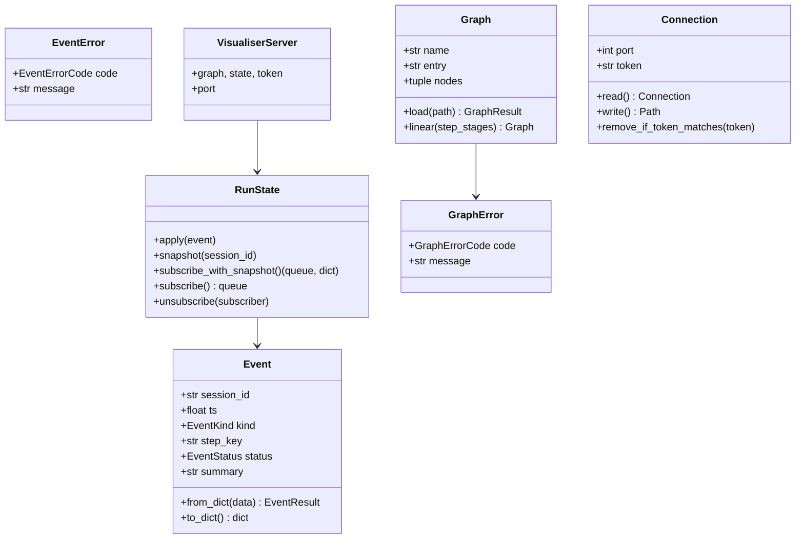

# Code Structure

## Build System
- **Type**: Python (hatchling) + Node (test-only) + bash (dev-loop glue)
- **Configuration**: `pyproject.toml` (project metadata, hatchling build backend, console
  script, pytest and ruff config); `uv.lock` (dependency lockfile); `opencode.json`
  (OpenCode agent config); `agentic-dev-loop/pipeline.yaml` (the repo's own dev/test/review/qa
  workflow); `apply-patches.sh` and `.aidlc/aidlc-patches/` (AI-DLC rule patches).

## Key Classes/Modules

### Existing Files Inventory

- `src/claude_workflow_viz/__init__.py` — package docstring and `__version__ = "0.1.0"`.
- `src/claude_workflow_viz/__main__.py` — `python -m claude_workflow_viz` support; calls `cli.main`.
- `src/claude_workflow_viz/cli.py` — argparse entry point; `serve` (with `--port`, `--graph`)
  and `hook` subcommands; hook path bypasses argparse for silence.
- `src/claude_workflow_viz/hook_command.py` — reads hook payload from stdin, normalises,
  POSTs to `/ingest`; always exits 0, never writes.
- `src/claude_workflow_viz/hook_adapter.py` — payload → `Event` normalisation; workflow
  identity from meta.json; journal result reading; step key resolution.
- `src/claude_workflow_viz/events.py` — `Event` schema, `EventKind`, `EventStatus`,
  `EventError`/`EventErrorCode`; `Event.from_dict` never raises.
- `src/claude_workflow_viz/run_state.py` — per-session steps/runs/events behind one lock;
  bounded memory; subscribe-with-snapshot.
- `src/claude_workflow_viz/server.py` — `VisualiserServer` (ThreadingHTTPServer);
  `/ingest`, `/stream`, `/graph`, static routes; Host/token/body checks.
- `src/claude_workflow_viz/graph.py` — `.viz.yaml` loader and validator; `Graph.linear`.
- `src/claude_workflow_viz/node_status.py` — verdict → status via `status_rules.json`.
- `src/claude_workflow_viz/connection_file.py` — token generation, state directory,
  atomic 0600 connection file.
- `src/claude_workflow_viz/static/index.html` — page skeleton (header, graph section,
  console aside, unmapped list, message line).
- `src/claude_workflow_viz/static/app.js` — DOM wiring: SSE, graph fetch with retry/backoff,
  Mermaid render only on change, class application, console pane, selectors.
- `src/claude_workflow_viz/static/viz-core.js` — pure reducer: initialState, applyEvent,
  nodeStatus, viewClasses, activeEdge, loopBackEdges, buildFlowchart, fingerprints,
  graphRetryDelaySeconds.
- `src/claude_workflow_viz/static/styles.css` — layout and status colour classes.
- `src/claude_workflow_viz/static/status_rules.json` — shared verdict → status rules.
- `src/claude_workflow_viz/static/mermaid.min.js` — vendored Mermaid (license file included).
- `tests/test_*.py` — one test module per source module plus smoke, server, static UI,
  implement-example and javascript tests (262 test functions total).
- `tests/js/viz-core.test.mjs` — Node test suite for the pure JS core (549 lines).
- `tests/fixtures/` — `probe_payloads.jsonl`, `status_cases.json`, `tree/` (payload fixtures).
- `examples/implement.viz.yaml` — example graph config for the agentic-dev-loop implement
  workflow.
- `docs/plan.md` — the original design plan (phases 0-4, risks, architecture).
- `agentic-dev-loop/pipeline.yaml` + `sdk_agents/*.agent.md` — the repo's own dev loop
  definition and its dev/review/qa agent prompts.
- `trigger-agentic-dev-loop.sh` — runs the dev loop via a pipx-installed engine.
- `apply-patches.sh` — applies AI-DLC rule patches from `.aidlc/aidlc-patches/`.
- `tools/import-opencode-tools.sh` — tooling helper.

## Design Patterns

### Typed-error results (railway style)
- **Location**: `events.py` (`EventResult = Event | EventError`), `graph.py`
  (`GraphResult = Graph | GraphError`), `connection_file.py` (`read` returns `Connection | None`).
- **Purpose**: Parsing and validation never raise; callers match on the union.
- **Implementation**: frozen dataclasses + StrEnum error codes; `from_dict`/`load` return the
  error object instead of throwing.

### Adapter / normaliser
- **Location**: `hook_adapter.py` (`normalise`, `step_key_for`, `_workflow_identity`).
- **Purpose**: Isolate Claude Code's undocumented payload shapes behind one function; the
  server and UI only see the normalised `Event`.
- **Implementation**: defensive `_text`/`_mapping` accessors; classification tables
  (`_RESPONSE_STATUSES`, `_MESSAGE_STATUSES`); never raises.

### Subscriber/observer with lock-protected snapshot
- **Location**: `run_state.py` (`subscribe_with_snapshot`, `subscribe`, `unsubscribe`).
- **Purpose**: Each SSE event is delivered exactly once: in the snapshot or on the queue.
- **Implementation**: subscribe and snapshot under one `threading.Lock`; per-subscriber
  `queue.Queue`.

### Reducer (unidirectional data flow)
- **Location**: `static/viz-core.js` (`initialState`, `applyEvent`).
- **Purpose**: The UI state is a pure function of (previous state, event, graph, rules),
  testable under Node without a browser.
- **Implementation**: immutable-ish updates via prototype-less dictionaries
  (`Object.create(null)`); event identity via stable stringify to deduplicate replays.

### Fail-silent forwarder
- **Location**: `hook_command.py` (`run_hook`).
- **Purpose**: The hook can never disturb a Claude Code session.
- **Implementation**: `contextlib.suppress(BaseException)` around the whole forward; exit 0.

### Config data with strict schema
- **Location**: `graph.py` (`Graph.load`, `_node`, `_reject_unknown`, `_UniqueKeyLoader`).
- **Purpose**: The graph is configuration data; typos fail loudly at `serve` start.
- **Implementation**: SafeLoader subclass recording duplicate keys; unknown-key rejection at
  every level; cross-field validation (entry, on_pass/on_fail references, stage/step_key
  ambiguity).

## Critical Dependencies

### PyYAML
- **Version**: `pyyaml>=6.0.3` (pyproject.toml)
- **Usage**: `graph.py` only — parsing `<workflow>.viz.yaml` with a SafeLoader subclass.
- **Purpose**: The only runtime library dependency; the YAML config is the graph data source.

### Mermaid (vendored)
- **Version**: in-tree `mermaid.min.js` (see `static/VENDORED.md` for provenance and
  `static/mermaid.LICENSE`)
- **Usage**: `app.js` calls `mermaid.render`; `mermaid.initialize` sets strict security and
  disables HTML labels.
- **Purpose**: Client-side flowchart rendering with zero network access.

### Python stdlib HTTP server
- **Version**: stdlib (Python ≥ 3.12)
- **Usage**: `http.server.ThreadingHTTPServer` / `BaseHTTPRequestHandler` in `server.py`;
  `urllib.request` in `hook_command.py`.
- **Purpose**: Loopback HTTP without any web framework dependency.

### pytest / ruff / node --test
- **Version**: `pytest>=8`, `ruff>=0.6` (dev group)
- **Usage**: `tests/*.py` (pytest), lint via ruff, `tests/js/viz-core.test.mjs` (Node).
- **Purpose**: The dev loop's verdict commands and local quality gates.
