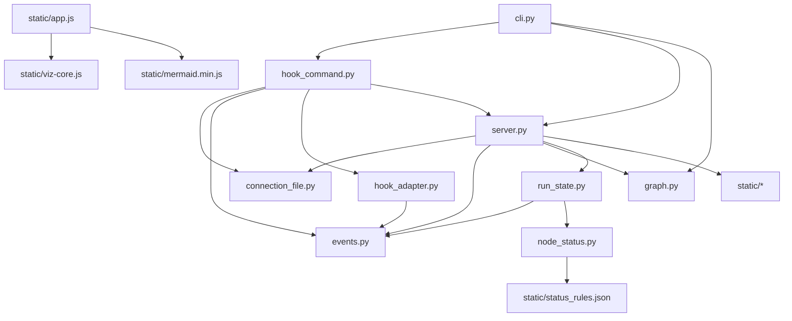

# Dependencies

## Internal Dependencies

### cli.py depends on hook_command.py, server.py, graph.py
- **Type**: Runtime
- **Reason**: Entry-point dispatch: `serve` builds the graph and runs the server; `hook`
  forwards to run_hook.

### hook_command.py depends on connection_file.py, events.py, hook_adapter.py, server.py
- **Type**: Runtime
- **Reason**: Read the connection file, normalise the payload, POST to the server's
  loopback address (constant imported from server.py).

### hook_adapter.py depends on events.py
- **Type**: Runtime
- **Reason**: Constructs `Event` objects and reuses the event error types.

### server.py depends on connection_file.py, events.py, graph.py, run_state.py
- **Type**: Runtime
- **Reason**: Token handling and connection file lifecycle, event parsing at ingest,
  graph document and linear fallback, run state for ingest and streaming.

### run_state.py depends on events.py, node_status.py
- **Type**: Runtime
- **Reason**: Stores and replays events; derives per-step display status from verdicts.

### node_status.py depends on static/status_rules.json
- **Type**: Runtime (package resource)
- **Reason**: The verdict → status mapping is a shared data file, not code.

### app.js depends on viz-core.js, mermaid.min.js
- **Type**: Runtime (client)
- **Reason**: The pure reducer holds all state logic; Mermaid renders the flowchart SVG.

## External Dependencies

### PyYAML
- **Version**: pyyaml>=6.0.3
- **Purpose**: Parse and validate the `.viz.yaml` graph config (SafeLoader subclass).
- **License**: MIT

### Mermaid (vendored)
- **Version**: in-tree minified build (see `static/VENDORED.md`)
- **Purpose**: Browser-side flowchart rendering.
- **License**: MIT (see `static/mermaid.LICENSE`)

### Python standard library (no extra packages)
- **Version**: Python ≥ 3.12
- **Purpose**: `http.server`, `urllib.request`, `hmac`, `secrets`, `queue`, `threading`,
  `importlib.resources` — everything else.

### Development-only
- **pytest** (≥ 8), **ruff** (≥ 0.6) — test and lint gates.
- **pip-audit** — dependency CVE audit in the dev loop's restore step.
- **agentic-dev-loop** (pipx-installed, outside the workspace) — the repo's own dev loop
  engine; not imported by the package.
